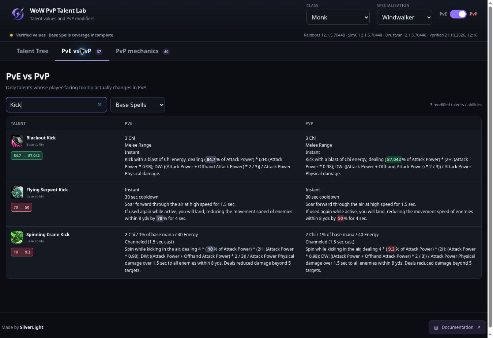

# Технический аудит Fun&Games — 20–21 октября 2026

**Исправления опубликованы и проверены на действующем сайте. Полностью исправленной систему считать нельзя: задачи [#7](https://github.com/silverlightwow/wow-pvp-talent-lab/issues/7) и [#15](https://github.com/silverlightwow/wow-pvp-talent-lab/issues/15) остаются открытыми.** Проверенные значения, свежесть источников и полнота охвата — отдельные свойства.

## Подтверждённый выпуск

| Что проверено | Доказательство |
| --- | --- |
| Основной пакет аудита | [PR #13](https://github.com/silverlightwow/wow-pvp-talent-lab/pull/13), merge [e853a074](https://github.com/silverlightwow/wow-pvp-talent-lab/commit/e853a074921ed336f1773a73a64d1df278e265a1) |
| Формулы и доказательство нулевого восстановления | [c3c737d](https://github.com/silverlightwow/wow-pvp-talent-lab/commit/c3c737d5f634a4a37ab86ce77563761655ea2285) |
| Принадлежность метаданных и проверки package PR | [ef3ae98](https://github.com/silverlightwow/wow-pvp-talent-lab/commit/ef3ae980dc2537f24d194f9f0c28f874a0881215) |
| Тесты Python | [39573922090](https://github.com/silverlightwow/wow-pvp-talent-lab/actions/runs/39573922090): 365 passed |
| Полная сборка свежих данных | [39573921974](https://github.com/silverlightwow/wow-pvp-talent-lab/actions/runs/39573921974): все 40 двойных сборок, все 10 браузерных jobs, frontend smoke и aggregate — success |
| Точный опубликованный набор | [0d35a21](https://github.com/silverlightwow/wow-pvp-talent-lab/commit/0d35a21712cffafbaf73547b16267cc7b4ae94ed) |
| Фактическая публикация | [39576830732](https://github.com/silverlightwow/wow-pvp-talent-lab/actions/runs/39576830732): routing, package, deploy и verify_publication завершились успешно; эти этапы не пропущены |

Проверка после публикации закончилась **21 октября в 12:29:58 EEST**. Совпали **120/120 файлов** действующего сайта. Возраст опубликованного манифеста составлял 0.15 часа, исходного capture — 0.43 часа. Настоящий Chromium посетил **40/40 специализаций при 1440 и 390 пикселях**, без browserErrors и без повторного прохода после ошибки.

В отдельном живом Chrome подтверждены Windwalker, фильтр Base Spells, поиск, Flying Serpent Kick 70% → 50%, разделённые варианты оружия и отсутствие ложной строки cooldown у Blackout Kick.

Итоговый набор: **12.1.5.70448**, 5 307 записей talents, 269 опубликованных записей базовых способностей, replay_verified_count 40, partial_count 0. В публичном каталоге нет unresolved/review-required записей. Условная применимость pet/racial учитывается отдельно; этот нулевой счётчик её не закрывает.

| Поле | Значение |
| --- | --- |
| source_captured_at | 2026-10-21T09:03:28.895966+00:00 — 12:03:28 EEST |
| source_snapshot_hash | 83470d6d60ee30121713f2556a9c0b018b37182f650b04f7bb513463fb27183d |
| parser_hash | e10ef23fbb50de5cd751ec28bb5572a5127fd365fd96f5b1e568d7156a5120de |
| hotfix_latest_date в снимке PvP-заметок | 2026-10-06 |

Ранее также успешно прошли [первый выпуск #13](https://github.com/silverlightwow/wow-pvp-talent-lab/actions/runs/39503798378), [следующий автоматический выпуск](https://github.com/silverlightwow/wow-pvp-talent-lab/actions/runs/39506672067) и [обновление 21 октября](https://github.com/silverlightwow/wow-pvp-talent-lab/actions/runs/39550412109). Во всех подтверждены deployment, 120 файлов и desktop/mobile проверки. [Независимая проверка свежести](https://github.com/silverlightwow/wow-pvp-talent-lab/actions/runs/39546075337) тоже прошла. Успех одного routing с пропущенным deployment не считается публикацией.

## История отказов

В начале аудита API показывал **266 исторических неудачных запусков**: 123 all-data, 55 freshness, 26 Python, 15 live-browser, по 6 publisher и recovery, 3 standalone-ability smoke, 4 Affliction smoke и 28 старых import/deploy/cross-spec. Это не 266 независимых текущих дефектов. Изучены метаданные всей этой истории, журналы актуальных отказов и представительные журналы каждой семьи.

- [39466409488](https://github.com/silverlightwow/wow-pvp-talent-lab/actions/runs/39466409488): 40 специализаций собирались, aggregate падал на устаревшем фиксированном ожидании cooldown.
- [39482209251](https://github.com/silverlightwow/wow-pvp-talent-lab/actions/runs/39482209251): возраст данных около 180 часов. Сигнал свежести был корректным.
- [38221077446](https://github.com/silverlightwow/wow-pvp-talent-lab/actions/runs/38221077446): выбор Marksmanship оставлял Beast Mastery dataset.
- [38255654224](https://github.com/silverlightwow/wow-pvp-talent-lab/actions/runs/38255654224): Elemental блокировала нерелевантная conditional формула; отдельная проверка обнаруживала проблему обновления worker/cache.
- [37842711064](https://github.com/silverlightwow/wow-pvp-talent-lab/actions/runs/37842711064): после deployment правильно отвергались данные возрастом 54 часа.

Старые диагностические отказы включали обращение к отсутствующему SimcEffect.text, изменение frozen fixture, неверный ожидаемый channel coefficient и отсутствующий импортируемый ZIP. Эти старые строки/сценарии не используются текущим выпуском. Не утверждается, что каждый исторический отказ повторно воспроизведён в прежнем окружении.

## Подтверждённые первопричины и исправления

| Область | Причина и итоговое поведение |
| --- | --- |
| Семантика эффектов SimC | Наличие AP/SP metadata ошибочно означало коэффициентный урон даже у скалярной ауры. Теперь способ расчёта определяется семантикой эффекта; лишняя AP/SP metadata сохраняется в происхождении данных. Синтетические тесты отдельно проверяют AP и SP. |
| Принадлежность Wowhead metadata | Полная HTML-страница содержит метаданные связанных заклинаний в scripts. Прежний поиск по всей странице мог применить чужой cooldown/charges при совпадении ID активной ауры. Теперь текст и metadata берутся из основной карточки с точными spell ID и заголовком; карточка с тем же именем и другим ID не подходит. |
| Нечисловой cooldown | Комментарий until canceled попадал в заголовок. Его нельзя считать числом. Удаление cooldown допускается только при взаимном exact-build доказательстве нескалируемого -100% модификатора с нейтральным PvP коэффициентом. Для категории зарядов проверяются категория и обратная ссылка; независимый обычный cooldown исключает такое упрощение. Недоказанный случай блокирует сборку. |
| Формулы оружия | Снятие квадратных скобок применялось к любому выражению и склеивало соседние варианты. Теперь только один AP/SP коэффициент теряет декоративную обёртку; исходные подписанные варианты сохраняются отдельно. Оружие игрока не предполагается. |
| Поиск Base Spells | Одних талантов недостаточно; прежний обход зависимостей имел произвольный предел глубины. Используются active/passive class/spec таблицы точного build, replacements и полный обход структурных зависимостей с защитой от циклов. |
| Независимый контроль охвата | Каталог не должен сам быть единственным списком проверяемых объектов. spellbook_inventory.candidate_universe содержит корни, идентичности эффектов, dependency paths, raw/current coefficients, применимость и причины пропусков. Необъяснённое отсутствие модифицированного class/spec эффекта блокирует сборку. |
| Blizzard hotfixes | Relative/property/removal заметка могла затронуть базовую способность вне каталога; повторный overlay рисковал удвоить уже включённое изменение. Проверяются exact-build принадлежность и конкретный переход. Прошлые значения не угадываются. Guard из PR #6 интегрирован в #13. |
| Постоянные пассивы | Разбиралось чужое условное выражение без ссылки на целевой эффект. Теперь сначала проверяется владение токеном, затем взаимные Modified By/Affected Spells связи и единицы источника. Релевантное нерешённое условие остаётся блокирующим. |
| Точность | Арифметическое выражение без .N получало шесть знаков. Учитывается явная точность либо целая по умолчанию, как в клиентском формате. Raw значения сохраняются отдельно. |
| Buff/nerf фильтры | Изменяемый фрагмент ошибочно считался одним числом. Ресурсные фразы и условные альтернативы сравниваются по всем парам при одинаковой форме текста. Смешанное направление сохраняется; неизвестная проза не объявляется buff/nerf. |
| Переключение dataset | Глобальные script-данные позволяли позднему ответу заменить новую специализацию. HTTP использует JSON конкретного запроса, отмену и проверку class/spec. Для file:// сохранены script-снимки. |
| Service worker | Немедленные skipWaiting/clients.claim смешивали старый документ с новым cache/fetch policy. Теперь обновление ждёт закрытия старых документов; их cache сохраняется до активации. Проверяются сохранность билда, активация, offline byte parity, иконки и изоляция чужого cache. Принудительной перезагрузки пользовательского билда нет. |
| Публикация | Несколько издателей и mixed source/UI push могли сочетать разные ревизии. Оставлен один сериализованный publisher; mixed push ждёт data workflow. Проверяется parser hash всех datasets, а routing, package и post-deploy verification фиксируют точный SHA. |
| Мониторинг | Работоспособность старой страницы не доказывала свежесть данных. Post-deploy проверки запускаются после настоящего deployment. Независимый монитор использует publication.json действующего сайта. Предел 12 часов для опубликованного набора и исходного capture сохранён; перепубликация старых источников не делает их свежими. |
| Регрессионные проверки | Live-проверки фиксировали старые tuning числа и написание иконки. Текущие изменения проверяются по текущим эффектам и точности их единиц; исторические tuning примеры остаются закреплёнными fixtures. Полный frontend suite работает и на свежесобранных данных. |
| Dependency PR | package*.json отсутствовали в pull_request фильтре полного workflow. Теперь изменения Python/npm package-файлов включены в соответствующие полные проверки. Иконки проверяются по исходным именам/кандидатам; app icon не подставляется как выдуманная иконка способности. |

### Flying Serpent Kick

Корень **101545 → зависимый 123586, эффект 2**, game effect **155942**. В проверенных снимках: буквальный base **-70**, PvP multiplier **0.714286**, raw произведение **-50.00002**, отображение **70% → 50%**. AP metadata **0.14742** не превращает скалярную ауру в урон от Attack Power.

Эти ID приведены для трассировки. В расчёте нет исключения для них, Monk или Windwalker. Проверки семантики используют синтетические идентификаторы.

### Проверка принадлежности источника

Свежий [прогон 39570609036](https://github.com/silverlightwow/wow-pvp-talent-lab/actions/runs/39570609036) остановил публикацию на Spiritwalker’s Grace: полная страница содержала cooldown-комментарий от связанного Elemental Blast. Guard не был ослаблен; исправлена область поиска метаданных.

На точных raw ответах этого запуска после исправления повторно прошли все 40 специализаций, каждое построение дважды. Независимая сверка **426** доступных full-page/tooltip пар дала **0 несовпадений metadata** и **0 неизвестных владельцев карточки**. Из обработки исключены **2 623 комментария вне выбранной карточки**, включая повторы собственных metadata в scripts и сведения связанных способностей. Это не число уникальных неверных эффектов.

Для этой диагностики использован snapshot **8e3587ec150faf5fdbff25185068173d8632c1e22657348fe6df47265da9aff0**, captured_at **2026-10-21T08:37:25.847635+00:00**, SimC ref **7bc10711b5a4514066fa402ca0a71c9ba4b7c9dd**. Смена парсера выполнялась в диагностическом ARCHIVAL_REPLAY. Для публикации затем заново собраны свежие источники итоговым кодом.

Raidbots задаёт topology и class/spec identities. SimC закрепляется commit SHA и exact build, предоставляет spellbook, descriptions, generated effects и зависимости. Wowhead/Drustvar сопоставляются по конкретным эффектам и build; старый источник не подменяет текущий молча. Blizzard даёт дополнительные официальные переходы с проверяемыми scope, датой и полем.

## Объём проверки

- Python: сначала 360 тестов в #13, затем **365** после пяти дополнительных обобщённых регрессий; publication policy покрыта 19 случаями.
- Archived 12.1.0.69933: 40/40 специализаций, двойные сборки с совпадением текстов, рангов и механики.
- Несколько fresh/диагностических 12.1.5.70448 прогонов всех 40 специализаций. Итоговый main-прогон использует свежий capture и обычный VERIFIED, не архивную публикацию.
- Numeric evidence: **6 358 tooltip/rank views, 1 622 source-supported replacements**. Новая проверка формул принимает исправленные данные всех 40 специализаций и отвергает прежний снимок со слитыми вариантами.
- Direction audit включает abilities: в проверенном fresh наборе **1 175** изменённых записей, без нераспознанного направления.
- Все 40 специализаций и hero trees при ширинах **2560, 1920, 1536, 1440, 1366, 1280, 1040, 1024, 390, 320**. Проверены геометрия, touch/rank взаимодействия, сравнения, mechanics, import/reload.
- HTTP selection/cancellation/worker проверки всех 40 при 1440/390, presentation при 1440/390/320, обновление worker, cache, offline и иконки.
- Локально применялся Chromium 153 с Playwright 1.62.1. Итоговые Actions использовали браузер закреплённого Playwright и Node 22; локальный результат не заменяет эти проверки.
- Фактический сайт после deployment: 120 hashes и 40 специализаций в каждом из двух Chromium viewport, плюс отдельная визуальная проверка в Chrome.

Равенство повторных сборок относится к source-derived содержимому: тексты, ранги, mechanics, числовые identities. Служебное время построения не считается числовым дрейфом. Реально изменившийся авторитетный источник может законно поменять значения внутри одного client build.

## Открытые задачи и ограничения

1. **#7: conditional охват не доказан.** Inventory содержит 128 conditional modified записей: 80 racial и 48 pet, то есть 18 уникальных корней — 2 racial и 16 pet. Class/spec таблицы не устанавливают pet-family/spec ownership и все допустимые race/class сочетания. Записи явно условные; отсутствие публичной способности не объявлено доказанным отсутствием эффекта. UI показывает Base Spells coverage incomplete. Полный поиск всех доступных условных способностей не завершён.
2. **#15: сложные вложенные описания не проверены полностью.** На странице Windwalker у Celestial Conduit остаётся подпись ветки Mistweaver внутри вложенной формулы. Клиентские ветки используют общие damage/healing эффекты в разном порядке. Это подтверждённая граница нормализации текста, а не доказательство неверного коэффициента. Полная привязка клиентских условий к специализации и восстановление отсутствующей у провайдера ветки не реализованы. Числовой gate не закрывает эту задачу.
3. **Wowhead HTTP 403 сохраняются.** В итоговом опубликованном каталоге **6 145 warning-записей** по 40 специализациям, все full-page HTTP 403; 3 826 уникальных source/spell/error троек. В первом main capture было 6 131, в раннем local — 6 864. Один запрос может повторяться в spec-отчётах. Tooltip endpoint и exact SimC/generated evidence разрешили значения, но успех каждого вспомогательного HTTP-запроса не заявляется. Полный перечень предупреждений сохранён.
4. **Нет испытания в игровом клиенте.** Не гарантирован разбор неизвестной будущей схемы, качественной правки или нового hotfix prose. Неподдержанный in-scope случай должен останавливать обновление и сохранять последний проверенный сайт.
5. **Raw артефакты хранятся 14 дней.** Полная независимая репродукция старого HTTP capture требует этих артефактов. Каталог содержит provenance, но не все исходные ответы.

PR **#1, #3 и #6** закрыты как заменённые интегрированной реализацией #13; для guard из #6 проверена идентичность AST. Повторно сливать старые ветки не требуется. Dependency PR **#4** (Playwright 1.64.1) и **#14** (artifact/setup actions) остаются открытыми, их изменения не включены в этот выпуск. Их старые результаты не выдаются за проверку итогового кода.

## Воспроизведение

~~~sh
python -m pip install -e '.[dev]'
npm ci
npx playwright install --with-deps chromium
python -m pytest -q
npm run test:smoke
~~~

Для полного повторения использовать source-plan/source-snapshot, raidbots-snapshot и official-pvp-hotfixes из нужного Actions run, код соответствующего commit и окружение из его журнала. Collector выполняет plan, четыре непересекающихся capture и merge с проверкой completeness/hashes. Задать WOW_PVP_SOURCE_SNAPSHOT, WOW_PVP_RAIDBOTS_FILE, WOW_PVP_HOTFIX_FILE и закреплённый WOW_PVP_SIMC_REF; выполнить scripts/build_all_site_data.py с --verify-replay, затем validation и браузерную матрицу.

Capture старше шести часов не используется для новой verified сборки. WOW_PVP_ARCHIVAL_REPLAY=1 предназначен для диагностики новым парсером: результат помечается ARCHIVAL_REPLAY, не пишется под web и отвергается publication validation. Capture timestamps и parser identity не подменяются.

Strict source-text gate применяется к свежесобранным и упаковываемым данным; отдельный compatibility smoke проверяет прежний снимок до замены. Publisher создаёт publication.json с SHA-256 инвентарём, проверяет точные live файлы и исходную свежесть, затем посещает все 40 специализаций при desktop/mobile ширинах. Полезные проверки не отключены ради зелёного результата.
